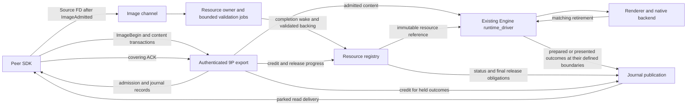

# How should one ISB presentation drive bounded work across owners

## Question

Which work obligations cause one ISB presentation to revisit the peer, file
export, image worker and native owner, and which repetitions can be removed
without moving authority, custody, deadlines or failure-observation boundaries?

niltempus requested this review after the positive candidate-27 CPU screen.
The scope is the complete execution model, not a replacement transport or a
new global reactor. Task state and acceptance remain in
[t331](../plans/mvbubiv9-reduce-shell-9p-allocation-overhead-against-the-paired-ipc-baseline.md#t331--reduce-shell-allocation-overhead).

## Current resumption

The source audit identifies three distinct kinds of work: mandatory current
observations, locally runnable state transitions, and obligations blocked on
a named dependency. A connected role is not necessarily runnable, but an empty
socket does not prove the role has nothing to do. In particular, current wire
service observes authority, expiry and side-channel state as well as data.
Suppressing the whole visit on socket readiness alone changes that contract.

Sophia already has an owner-input/publication-flush split, bounded peer progress,
one-shot readiness identities, wake-before-inspection ordering, bounded image
jobs, and credit-dependent terminal publication. These are foundations to
preserve, not missing mechanisms to replace. Engine's `runtime_driver` remains
the visual sequencing owner; Session schedules and supervises its adapters.

This review specifies a cross-owner obligation model, failure controls and an
evidence gate below. No production scheduler, public API, SDK pin or protocol
change is implemented by this investigation. Claude's completed upstream scheduling research is integrated below, with
source facts kept separate from measurements and proposed transfers.
No current evidence justifies skipping whole owner or wire visits while
claiming unchanged authority and current-call observations.

## Source and evidence identity

The source audit reads production `49960dd7b` (code unchanged from `7fca9e0e2`),
comparator `16faa7a91`, and the vendored Rust SDK revision
`c6ad4fa04395565297beeecaa18edc459ad9cb01`. Production and comparison transport
differences are intentional; do not use the retired IPC adapter as a production
contract. The benchmark's closed-loop frame production is not a claim about
all real clients.

Evidence root: `~/.local/state/sophia/development-evidence/t331-isb-cost-20261018/`.

| Evidence | What it establishes | What it does not establish |
| --- | --- | --- |
| `candidate-27-property-cache-screen/results.json`, receipts and capture hashes | Same-workload CPU reduction on both wires; eight successful 1000-presentation joins | Allocation savings, new ioctl/visit counts, or full t331 acceptance |
| `candidate-19-current-hotspots/` | Historical instrumented stacks locate pipeline, image-probe, custody and renderer work | Current uninstrumented durations or removable-cost ceilings |
| `candidate-16-peer-polls/interval.json` and `candidate-17-peer-send-polls-retry/interval.json` | Repeated pipeline rounds, sends and empty/productive reads can be correlated | Counterfactual savings or unchanged reply-observation timing if reads are skipped |
| `candidate-18-sdk-read-scheduling/results.json` and `candidate-25-listener-probe-screen/results.json` | Neither established a CPU benefit under its own tested identity | Permission to revive either from source reasoning alone |

C27 new-arm means are approximately 1123/902 us per frame for files/IPC Session
and 370/240 us for the peer. The descriptive gap is about 352 us; closing to
+10% at that IPC baseline would require about 238 us less files CPU. Wire blocks
ran at different times, so this is sizing, not a qualification pair. Shared
renderer savings must be applied to both arms and may increase the percentage
gap. Counts, inclusive stacks and phase totals overlap; never add them as
independent costs or subtract tracing overhead to invent native durations.

## Existing causal path

The table is a source-derived dependency map, not a timestamped trace proving
that all transitions occur in distinct passes or in the order that independent
events happen to arrive. Setup precedes the steady-state frame; retirement can
outlive it.

Session's existing owner loop schedules these adapters and handles process,
seat and recovery policy. The arrows do not give it ownership of their states
or replace Engine sequencing. Every operation still crosses its current
authority boundary.

| Transition | Owner and trigger | Result and next dependency |
| --- | --- | --- |
| Authenticate and discover | Role root plus SDK; authenticated connection and image discovery | Hello is checked against custody/epoch; ChannelReady enables image admission |
| Prepare immutable source | Peer `MappedIsb`; new resource contents | Fresh backing is populated and sealed; holding an FD does not admit the resource |
| Submit ImageBegin | SDK/FileWire and authenticated export; queued transaction | Ordinary submit/receipt/ACK machinery reserves admission budget and journal space; ImageAdmitted permits descriptor transmission |
| Transfer Source | Producer dispatch and image service; admitted offer plus socket progress | Match exact offer/epoch/metadata, seals and backing size; source goes to a reserved validation job |
| Validate and settle | Bounded worker plus `ShellIsbImageOwner`; job, completion, cancellation or deadline | Validated immutable backing enters resource custody; status and SourceReleased publication can remain credit-blocked |
| Submit content referencing the resource | Peer plus role service; resource readiness and content demand | Admitted content becomes an Engine preparation obligation; a receipt is not presentation evidence |
| Compose, submit, retire | Existing runtime driver and backend; admitted state, pacing and KMS progress | Matching retirement permits presented feedback; unrelated traffic cannot prove presentation |
| Deliver feedback and ACK | Export journal and SDK; pending records, parked read, receive progress | Records remain retained until covering ACK; ACK may unblock admission, refusal and release publication |
| Retire resource | Resource store and all consumers; explicit retirement/revocation plus last lease | On a live journal, ResourceReleased must fit before final charge release; a dead journal drops the event obligation, not outstanding consumer safety |

The published [ISB lifecycle](../../sophia-image-channel.md#custody-and-lifecycle)
owns these ordering and custody rules. SourceReleased does not make sealed
memory writable. KMS retirement does not necessarily end snapshot or renderer
leases. The owner-allocated mutable-pool idea does not solve retained writable
mappings and is outside this review.

## Actual scheduling boundaries

1. **Session pass.** `OwnerWake::begin_pass` clears the owner wake before
   inspecting producers, never between inspection and sleep. `physical_input_loop`
   services component work, lifecycle/native work and authority phases within
   existing order. Lifecycle drains retirement-authorized feedback before a
   subsequent no-work exit. The wait combines descriptors and deadline caps;
   pending local work is not inferred solely from fd readiness.
2. **Connected component visit.** `ShellComponentSession::finish_poll` calls
   `turn_connected`; each connected transport receives an owner input turn,
   followed by image-owner service. The image owner drains completions and
   handles epoch loss, expiry, source submission and held publications. Its
   lifetime can exceed the connected role so retired work can still settle.
3. **Wire turn.** `ShellFileWire::service` consumes readiness once, performs
   export polling before and after server service, then expires state and
   services the image channel. The Ready image channel checks its peer before
   receive. `LaunchCustody::is_live` polls exact pidfds and brackets that poll
   with the active flag. These are fresh observations, not reusable metadata.
4. **Role publication.** After an owner turn, `ShellComponentTransport::poll_io`
   drains outgoing records and flushes only when publication is pending. It
   does not necessarily create another input turn. `check_ack_progress` runs
   only after input service, since an ACK may already be waiting in the socket.
   Treating every role call as a redundant full wire visit is incorrect.
5. **9P retry/flush.** `Server::flush` drains export wake work, retries waiting
   reads and writes queued replies without reading new requests. `read_now`
   performs `export.check` before a buffered read; moving it after consumption
   changes the authority boundary. Write-path retries also exist; a transport
   cannot assume every export state change arrives through one wake source.
   Guarded replies retain their original node/epoch; `Connection::write_output`
   uses `with_delivery` for partial delivery, and `AuthenticatedExport` checks
   again there. A queued authorized read is not permanent permission to send
   its remaining bytes after revocation. Not every reply is delivery-guarded;
   the export's guard policy determines that boundary.
6. **Peer drive.** FileWire loops within `MAX_ROUNDS`, and shared dispatch
   budgets bound syscall attempts and bytes. Each ordinary Pipeline poll writes
   then reads. Reply handlers and local ACK/fetch/submit work can cause another
   round. `service_pending` preserves unfinished bounded work. Completed replies
   preceding EOF are recovered before custody is classified. `wait_for_io`
   performs a drive, waits on both sockets, and discards readiness; image tick
   currently probes its fd again. Reusing that observation requires identity
   and state validation, not just storing a bit.

Source anchors, relative to the repository root:

| Responsibility | Implementation |
| --- | --- |
| Session sequencing and wait obligations | `crates/sophia-session/src/live_session/owner_loop/physical_input_loop.rs`, `lifecycle.rs`, `owner_held_work.rs`, `wait_plan.rs`; `live_session/owner_wake.rs` |
| Component service and readiness | `crates/sophia-session/src/live_session/metadata_shell/component_session.rs`; `crates/sophia-session/src/shell_component_connections.rs` |
| Input/publication separation | `crates/sophia-runtime/src/shell_transport.rs`: `service_owner_observed`, `poll_io`, `turn_files`; `shell_transport/files.rs`: `service` |
| Worker completion and settlement | `crates/sophia-runtime/src/shell_content/isb_worker.rs`: `take_completed`; `shell_transport/image_owner.rs`: `service` |
| Fresh authority | `crates/sophia-session/src/launch_authentication/files.rs`: `check`, `poll`, `wait`; `crates/sophia-runtime/src/supervisor/launch_custody.rs`: `is_live` |
| 9P progress | `crates/sophia-9p/src/unix.rs`: `turn_observed`, `flush`, `service_wake`, `write`; `connection.rs`: `read_now`; `connection/delivery.rs`: `write_output`; runtime `authenticated_files.rs`: `with_delivery` |
| Peer progress | Vendored `sophia-shell-client/src/files/drive.rs`, `lib.rs`, `files/image_adapter.rs`; `sophia-9p-client/src/pipeline.rs` |

## One obligation model, without a second coordinator

Use the following classification to reason about existing owners. These are
analysis categories, not a proposed public enum or a second queue beside the
real state. Do not copy state into a new scheduler unless its synchronization
and invalidation contract is proven.

| Work class | Becomes actionable when | Must remain represented while blocked |
| --- | --- | --- |
| Fresh observation | Current service/operation boundary or existing deadline requires it | Existing freshness/custody contract; empty readiness cannot discharge it |
| Local transition | Buffered input, queued output, completion or other owned state can advance | Exact queue/item and identity; budget exhaustion means runnable again, not quiescent |
| Socket dependency | Required bytes, write room or a join may be available | Descriptor plus connection/generation and current interests; partial I/O survives |
| Credit dependency | ACK, capacity release or terminal journal reservation becomes available | Original record, ordering, charge and custody; no synthetic completion |
| Worker/native dependency | Matching completion, KMS retirement or consumer lease ends | Exact job/frame/resource identity; cancellation does not fabricate completion |
| Time dependency | Existing retry, validation, handshake or maintenance deadline is due | Original absolute deadline; packet activity and retries cannot renew it |

Notification is an invitation to inspect owned state, not the state itself.
Duplicate notifications may be coalesced only while the real obligation remains
represented. A notification arriving during service must survive the transition
to idle. A full journal must not spin on an already-decided expired refusal;
the image owner already remembers the refusal and waits for ACK progress.
Budget exhaustion must re-expose immediate work without requiring another fd
edge. A missing, stale or incomplete readiness observation must use today's
fallback. Do not hide unfinished work by returning a generic idle flag.

Keep visual sequencing in Engine's `runtime_driver`; protocol custody in its
export/SDK owners; image jobs and backing in their resource owners; and process,
seat and recovery policy in Session. Readiness tokens, queued work identities,
authority observations, admission credits and retirement evidence are different
facts. None substitutes for another.

The current authentication wait remains a 20 ms bounded cadence for launch
exit, revocation and deadlines without peer traffic. Combining that deadline
with other waits is not permission to lengthen it or replace fresh operation
checks with a timer result. Immediate credit or completion progress must not
be made to wait for that maintenance cadence.

### Stability and invalidation

| Fact | Valid lifetime | Forbidden reuse |
| --- | --- | --- |
| C27 property IDs | Opened-card identity, target generation and object IDs, with explicit invalidation | Device replacement, topology preparation or failed I/O |
| Socket readiness observation | Exact registered connection/fds/interests and generation, consumed once | Reconnect, fd-number reuse, intervening service or changed state |
| Authority result | Existing operation/service observation boundary | Later operations merely because they share an owner pass |
| Admitted offer | Exact epoch, offer, resource metadata, reserved budget and original deadline | Reused resource ID, late packet, cancelled or expired admission |
| Validated backing | Immutable resource and outstanding consumer ownership | Writable pool reuse or inferring last-consumer release from page flip |
| Journal credit | Exact retained records, reservations and covering ACK | Read delivery alone, event enqueue alone or coalesced terminal outcomes |

## Prior art: transferable invariants, not a framework replacement

Claude's read-only source survey screened the following implementations. Pins
identify inspected source, not necessarily the host's running versions. Root
also inspected the NAPI completion edge, Tokio readiness clearing, libuv pending
queue and Seastar sleep-entry code. No upstream benchmark here establishes a
speed ranking or a Sophia saving.

| Source | Relevant mechanism | Boundary of the analogy |
| --- | --- | --- |
| [Linux v6.18 NAPI](https://github.com/torvalds/linux/blob/7d0a66e4bb9081d75c82ec4957c50034cb0ea449/net/core/dev.c#L6607) | `napi_schedule_prep` keeps SCHED and records MISSED when already scheduled; completion reschedules if MISSED; poll budgeting supports repoll | Kernel interrupt/softirq ownership is not a user-space authority or journal contract |
| [Tokio 1.53.1 task state](https://github.com/tokio-rs/tokio/blob/75fef53d0a8590c2d1dbb63672aa7b7d1ef51155/tokio/src/runtime/task/state.rs), [readiness](https://github.com/tokio-rs/tokio/blob/75fef53d0a8590c2d1dbb63672aa7b7d1ef51155/tokio/src/runtime/io/scheduled_io.rs) and [Mio 1.2.4 epoll](https://github.com/tokio-rs/mio/blob/79d1417c94e3a45c8bdd796e5422e22e8c488086/src/sys/unix/selector/epoll.rs) | A notification received while running survives to rescheduling; readiness clearing checks the driver tick so an older observation does not erase a newer event | Mio's edge-triggered backend and Tokio's retained readiness are not Sophia's current level-triggered observation contract |
| [Seastar reactor](https://github.com/scylladb/seastar/blob/19ecc0d39feb36c8a10692ba262e9924e9f7df33/src/core/reactor.cc#L3039) | SMP interrupt-mode entry announces sleeping, orders that announcement and rechecks; `pollers_enter_interrupt_mode` rolls back earlier pollers if a later one cannot sleep | Its shard/poller and busy-poll assumptions do not justify adding spin time or another global coordinator |
| [sd-event v257](https://github.com/systemd/systemd/blob/70bae7648f2c18010187c9cf20093155eaa26029/src/libsystemd/sd-event/sd-event.c#L1137) | Pending source queue, accumulated I/O revents, priority and deadline handling | Priority dispatch is not automatically fair; its polling frequency is not a performance prescription |
| [libevent 2.1.12](https://github.com/libevent/libevent/blob/5df3037d10556bfcb675bc73e516978b75fc7bc7/event.c#L1767) | Active-list membership suppresses duplicate insertion; configured callback/time bounds limit dispatch | Configuration and callback behavior determine fairness; not evidence that Sophia lacks bounded service |
| [libuv 1.51.0](https://github.com/libuv/libuv/blob/5152db2cbfeb5582e9c27c5ea1dba2cd9e10759b/src/unix/core.c#L842) | Pending callbacks are removed from a snapshot queue before invocation; `uv__io_feed` inserts only when not already queued | Duplicate suppression and callback rescheduling do not discharge unrelated authority or deadline work |
| [diod](https://github.com/chaos/diod/blob/de51d1ee1bd5ccf1d8c16b96227c8bb03ec50106/src/libnpfs/srv.c#L176) | Connection readers feed request queues serviced by worker pools | A request queue is not an owner-runnable token. Tauth/Tattach authenticate; operations resolve fids and use the fid user for backend filesystem permission checks. That is not Sophia's repeated fresh grant/admission check |

These are different designs. Do not claim that every source uses the same
one-token-per-object scheduler, tail requeue policy or authentication model.
The useful common question is how real pending work survives notification,
budget exhaustion and the transition to sleep.

### Three mechanisms examined in depth

**Retain a notification received while running.** NAPI's SCHED/MISSED state and
Tokio's running/notified transitions provide two implementations of this
invariant. Sophia already preserves concurrent rings by clearing before
producer inspection; it has no demonstrated lost-wakeup defect here. If a new
per-owner runnable predicate is ever introduced, it must preserve arrivals
during service and unfinished budgeted work. Clearing an entire cause set at
return can erase such an arrival. The transfer point would be existing
component/transport state, not a new visual coordinator. A controlled wake
during dispatch and a budget-exhaustion negative control are required; count
duplicate visits and real progress before assigning any cost benefit.

**Do not erase newer readiness with an older observation.** Tokio's tick-checked
clear is a concrete precedent. Sophia's server already validates identity,
generation, interests and descriptors before consuming an observation. The
unimplemented SDK wait-to-image-tick handoff has a similar requirement but
cannot simply copy Tokio's edge-triggered policy: journal routing and discovery
can replace or remove the producer fd before dispatch. The counterexample is an
old empty observation suppressing a probe on a replacement channel. Test that
identity/state changes force the ordinary probe, HUP remains observable and
direct dispatch without an observation retains its existing behavior. Measure
only the eligible repeated probes, not every image tick. Historical counts
alone did not establish a worthwhile candidate.

**Prove all obligations are safe before sleeping.** Seastar's multi-poller
interrupt-mode transition is a useful proof pattern, not a design to import.
Sophia already publishes work before waking, clears before inspection, collects
wait fds and caps deadlines. Its worker completion path also clears before
queue inspection. The review application is to enumerate every producer and
blocked dependency: an omitted credit, completion or teardown obligation can
strand work even when socket readiness is handled correctly. Tests must inject
work at the inspection-to-wait boundary and after cancellation/reconnect. A
maintenance timer eventually hiding a lost wake is not proof of correct
immediate progress. No busy-poll interval or timer adjustment is proposed.

## Candidate decision and measurement gate

**Do not implement a broad ready-only component scheduler yet.** The initial
source hypothesis is to represent local actionable work and blocked dependencies
more precisely at existing boundaries, while leaving mandatory observations
where they are. That hypothesis is not a selected production optimization: the
current unconditional component visit also performs live checks and expiry,
and the existing publication split has already removed some apparent repeats.

A candidate must identify one concrete repeated operation, the unchanged input
or redundant observation that makes it removable, the owner of that fact, and
every invalidating event. It must also show that the remaining work can run at
its existing boundary. If it needs fewer authority observations or changes which
call surfaces disconnect, retry or custody, present that as a separate contract
decision. Do not disguise it as an internal queue optimization.

Separate two questions about authority rather than treating every current call
as either inherently necessary or automatically redundant. Fresh authorization
before consuming or exposing protected state protects the operation itself.
Proactive checks on an otherwise idle connection also determine when callers
observe loss and cleanup. A different scheduler might preserve the former but
change the latter. That could be a design proposal, but it is not established
equivalence and is outside the initial preserve-boundaries candidate. The
operation, deadline, idle-observation and cleanup guarantees must each be stated
before such a proposal can be evaluated.

Specific omitted-trigger counterexamples rule out a socket-only predicate:

- a newly installed connection needs its first owner turn even without a saved
  readiness observation;
- a worker completion or retained job can belong to a retired grant after its
  current wire disappears;
- channel-only loss can require withdrawal while the 9P journal remains live;
- ACK progress can make a held refusal or ResourceReleased publishable;
- an absolute deadline can select an outcome with no new socket bytes;
- a same-connection write or local export change can make a parked read ready;
- queued output needs write progress even if no new input is expected;
- a final reply and EOF can settle custody in the current call, not merely on
  the next time an owner happens to be scheduled.

### Existing C27 wait attribution: the first discriminator

The retained CPU-only logs already contain cumulative `OwnerWake` and
`WaitAttribution` snapshots. Re-analysis uses the earliest and latest paired
snapshots strictly inside each workload interval, rather than including the
long idle tail after presentation ends. Each window covers about ten seconds
and 600 completed presentations. These are partial, non-frame-aligned windows,
not reconstructed full-run totals.

| C27 run | Wire / arm | Owner passes = waits | Non-native fd-ready waits | Native-ready waits | Deadline expirations |
| --- | --- | ---: | ---: | ---: | ---: |
| 1 | files old | 8672 | 7472 | 600 | 600 |
| 2 | files new | 8687 | 7487 | 600 | 600 |
| 3 | files new | 8640 | 7440 | 600 | 600 |
| 4 | files old | 8697 | 7497 | 600 | 600 |
| 5 | IPC new | 5221 | 4021 | 600 | 600 |
| 6 | IPC old | 5233 | 4033 | 600 | 600 |
| 7 | IPC old | 5181 | 3981 | 600 | 600 |
| 8 | IPC new | 5203 | 4003 | 600 | 600 |

Every expiration in these windows is attributed to `service`. Ring-ready
counts are zero. The files authentication cap is selected 8040–8097 times,
but expires **zero** times. A selected cap is not the cause of the wake.
Ready flags can overlap in general; this table does not redefine them as
mutually exclusive categories. Selected-reason totals reconcile to waits,
and expired-reason totals reconcile to deadline expirations in all eight runs.

Files therefore performs about 14.4 passes per observed completion versus
8.7 for IPC; the excess is associated with non-native fd readiness, while
both have one service-deadline expiration per completion. This rejects the
hypothesis that extra 20 ms authentication timer expirations explain these
interior passes. It does **not** identify which descriptor, protocol exchange
or local transition caused a wake, establish empty visits, or authorize fewer
fresh checks. Whole-run authentication expirations include the idle tail and
must not be attributed to presentation work.

Reproduction and input hashes are retained under evidence root
`execution-model-review-20261019/`: `analyze_waits.py`, `wait-windows.json` and
`SHA256SUMS`. The analysis reads the original `pc27-1..8` logs and samples;
no capture or original evidence was changed.

Before adding fields, audit the existing comparator service ledger's meanings.
In particular, `wire_no_publication` is incremented after the optional input
turn when `publication_pending()` is false. It does not say that no request,
ACK, authority observation or image work occurred. These counters can size
publication paths, but cannot alone classify an entire visit as empty.

### Follow-up source audit: fd-ready is not socket-ready

`OwnerWake::wait` counts any ready descriptor before `native_start` as
`owner_fd_ready`. `authority_receive` builds that prefix from the legacy shell,
component registrations and authenticated-launch relays. Component registration
also includes pending image-worker completion fds. Consequently the observed
files excess cannot yet be called extra client messages or socket wakeups.
Zero `owner_ring_ready` only describes the owner ring, not all internal wakes.

| Descriptor producer | Meaning of readiness | Boundary that consumes it |
| --- | --- | --- |
| 9P server `reader` pipe, first in `Server::visit_poll_fds` | Local export notification or stop | Input service drains it only when its observed flags contain IN; publication flush drains it unconditionally |
| 9P accepted socket | Input, output room, closure or error according to registered interests and returned flags | `Server::serve` / `write_ready` |
| 9P listener, where present and capacity allows | New connection | `Server::accept` |
| Image listener, omitted during active accept backoff | New or duplicate side-channel connection | Image service accept path |
| Image Hello/Ready socket | Hello, Source, closure or error | Image service state machine |
| Image-worker completion fd, registered when jobs are pending | Completed validation or worker exit | Image owner drains completions, including jobs from retired epochs |
| Authenticated-launch relay and legacy-shell descriptors | Independent launch or shell obligations | Their own registered consumers |
| Native descriptors and owner ring | Separate categories already counted | Native feedback and owner command/notification handling |

Source anchors: `sophia-session/src/live_session/owner_loop/authority_receive.rs`,
`owner_wake.rs`, `sophia-session/src/shell_component_connections.rs::subscribe_wait`,
its `images.rs::visit_worker`, `sophia-runtime/src/shell_transport/files.rs::visit_poll_fds`,
`files/image.rs::visit_poll_fds`, and `sophia-9p/src/unix.rs::visit_poll_fds`.
Paths are relative to `crates/` except the owner-loop sibling `owner_wake.rs`.

One correction to the research handback matters: ordinary `Server::serve`
invokes `service_wake` only when the wake descriptor has IN. It does **not**
drain the pipe and retry every parked read on every input turn. `flush` does
invoke it unconditionally, and successful output writes separately resume
requests and retry parked reads. Likewise `Wake` is a nonblocking pipe here,
not an eventfd. A notification calls `write`; a full pipe already retains the
wake. These distinctions change which repeated operations are even candidates.

### Smallest next diagnostic: classify observed wait sources

First split the existing fd-ready population, before attempting full protocol
causality. Candidate 28 implements this diagnostic in comparator commit
`c053eb5aa1391ddbde09ddba8bf791c51537c231`, gated by the existing
`comparator-progress` feature. Production scheduling is unchanged. It consumes
only the successful wait's existing returned flags, adds no poll or clock read,
and uses bounded inline storage rather than per-wait allocation. Its CPU overhead
is not zero; keep it separate from CPU acceptance builds.

1. Assign descriptor roles at their registration sites, alongside the actual
   descriptor and its component/epoch identity. Do not infer roles from raw fd
   numbers or assume image index 2: listener backoff changes the list, and
   general 9P servers may also register a listener. Worker registrations can
   outlive a connected wire and must remain represented.
2. Accumulate a bounded histogram of ready-role combinations per completed
   wait, with separate IN, OUT and HUP/ERR/NVAL marginal counts. Preserve
   simultaneous causes rather than assigning one arbitrary winner. Keep a
   counted unclassified category and refuse an attribution claim if it is
   nonzero. The histogram total must equal waits; its non-native-ready union
   must equal `owner_fd_ready`. Native/ring unions must match existing counts.
3. Emit cumulative snapshots with the existing monotonic timestamp and compare
   only snapshots wholly inside the joined workload interval, as above. Record
   the component set and exact descriptor-role schema with the artifact pins.
   Frame normalization is descriptive; it does not establish a causal link
   from an individual wake to a particular generation.
4. Exercise simultaneous socket/worker readiness, idle timeout, server-pipe
   notification, HUP, listener backoff, replaced fd/epoch, retained worker and
   legacy/relay registration in offline tests. A deliberately misclassified
   source must fail reconciliation. Feature-off code and all wait, authority,
   expiry and service decisions remain unchanged.

Interpretation determines the next slice. If socket IN dominates, correlate
accepted 9P request kinds with the existing read/write and ACK/submit paths;
request counts alone still do not establish causality. If the server pipe
is material, trace local publication/stop notifications through their drain
boundary before considering coalescing. If workers dominate, join completion
and submission identities before claiming repeated completion service. OUT,
closure and negotiation require their own interpretation. None of these
outcomes grants permission to skip a visit or weaken its fresh checks.

The existing service ledger is a useful secondary reconciliation, not a
substitute: `wire_owner_input` counts entry into an input service,
`wire_flush_useful` means bytes were written during the flush scope, and retry
outcomes classify attempted retries. Neither an input-service count nor a
no-byte flush establishes whether a whole visit did useful semantic work.

### Candidate 28 implementation status

The comparator emits `sophia_wait_sources schema=1` beside existing owner
statistics with the same monotonic timestamp. A sparse histogram records the
combination of ready roles per successful wait; IN/OUT/fault marginals count
waits rather than individual descriptors. Both ordinary and bounded-service
waits rebuild and consume their registrations. Native and ring regions come
from the actual polled slice. IPC/negotiation have a separate category; they
cannot hide missing file-wire tags. Unknown-ready roles, conflicts, registration
overflow and missing scopes are explicit refusal conditions for attribution.

Retained evidence: `candidate-28-wait-sources/README.md`, command/exit JSON,
unfiltered logs, source patch and `SHA256SUMS` under the evidence root. Six ledger
tests and nine server readiness tests pass; 26 owner-wake tests pass; the image,
owner-turn and transport-readiness controls pass. The actual server registration
test fails when its wake-pipe tag is deliberately changed to a socket tag, and
passes after restoration. Feature-disabled native Session compilation and
feature-enabled Clippy gates pass. A worst-case record fits the existing capture
line bound. The default SDK, source protocol and authority paths are untouched.

**Initial native diagnostic refused.** Both `wait28-*` runs completed and
joined 1000 presentations; PAM/tty cleanup succeeded with no residual processes.
The interior files window recorded 34,908 tag conflicts over 8,727 waits; IPC
recorded 10,392 over 5,196. These are diagnostic errors, not workload errors or
hotspot measurements. Relays wrap the same 9P server: the inner visitor tagged
its fds as wire sources before the outer visitor tagged them as relay sources.
The analyzer also rejected an interleaved owner-wait/counter record after the
files workload. Original captures, scripts and pins are preserved; refusal and
capture hashes are in `candidate-28-wait-sources/REFUSED.json` and
`capture-SHA256SUMS`. No role attribution is accepted from this run.

Comparator `dc2e6e73e` fixes the nested registration with a scoped owner context
set before entering the relay visitor. A real nested-server test passes and
fails when that context is deliberately ignored. The three periodic wait rows
now use complete newline-terminated writes on the sampler's stderr stream,
bounded by 4096 bytes; oversized/write-error records force diagnostic refusal.
The existing diagnostic capture hook is preserved, and feature-off output is
unchanged. This remains diagnostic-only; it changes no scheduling or authority.

**Retry accepted for count attribution.** Both `wait28r-*` runs joined 1000
unique presentation generations and cleaned up successfully. The original
offline analyzer swapped owner statistics and wait reasons by positional
unpacking; `offline-analysis-v2` selects records by name and adds an end-to-end
stage test. Original launch files and hashes remain preserved; no rerun was
needed for this parser correction.

The approximately ten-second interior windows contain 599 files completions
and 600 IPC completions. Files has 8,595 waits: 6,503 9P-only, 295 simultaneous
9P/image, 598 worker-only, 600 native-only and 599 deadline-only. IPC has 5,173:
3,973 transport-only, 600 native-only and 600 deadline-only. Every mask and
reason reconciles; conflict, overflow, missing-scope and unknown deltas are
zero. Server wake pipes, relays, listeners and the ring contributed no ready
waits in these windows. Image readiness overlaps 9P and is not additive.

This is 14.35 versus 8.62 waits per completion, a count result from one
diagnostic pair, not a duration or savings estimate. The next source audit
should map socket wakes to request/reply, ACK, admission and publication
dependencies, with worker completion accounted separately. It does not support
broad idle-wire gating or weaker observation boundaries. Evidence and input
hashes: `candidate-28-wait-sources-retry/offline-analysis-v2/`.

The remaining discriminator is an obligation census at the existing
component/transport boundaries on the C27 baseline: distinguish owner input,
publication, worker completion and maintenance causes; count actual state
progress, blocked dependencies and mandatory observations independently. Cause
sets may overlap. A fresh check with no data progress is not classified as
removable no-work. Reconcile those counts to the existing wire-turn and frame
totals before inferring a target. Existing retained traces cannot provide this
complete cross-owner attribution. This review does not add instrumentation or
launch another capture; any diagnostic slice must be specified separately and
kept out of CPU acceptance builds.

## Failure controls and acceptance

| Scenario | Required result / existing test surface to extend |
| --- | --- |
| Work arrives before, during or just after idle transition | No lost wake or indefinite sleep; `sophia-session/tests/support/owner_wake.rs`, `sophia-runtime/tests/shell_isb_worker.rs` |
| Stale observation, replaced descriptor or reconnect epoch | Safe ordinary probe, no cross-owner state; `sophia-9p/tests/unix_readiness.rs`, runtime transport/image readiness tests |
| Budget exhausted with buffered work, peer remains busy | Bounded service, eventual progress, neighboring owners and deadlines still serviced; SDK pipeline/scripted FileWire and Session owner-scheduling tests |
| Full journal, ACK already buffered, held refusal/release | Input first; no false stalled-peer verdict, lost terminal or busy retry; runtime output-custody and ISB-resource tests |
| Worker completes during wake clearing or after revocation | Exact completion consumed once, no stale publication, backing remains charged as required; worker/shutdown/image-owner tests |
| EOF after valid replies, write error, failed admission | Preserve current-call errors and custody ordering unless separately approved; SDK scripted FileWire tests |
| Guarded reply queued before revocation, then a partial send | Recheck the original node/epoch at delivery; scheduling and fid reuse cannot grant remaining bytes; 9P delivery and authenticated export tests |
| Seat/topology loss or retained last consumer | Cancel/retire exactly once; preserve presentation proof and last-consumer release; Session retirement tests and runtime resource tests |

Test the real production path and include a negative control that breaks the
proposed invariant. Passing a helper test cannot prove that the owner loop uses
the helper. Cover input, lock and other roles under a busy image producer;
single-peer throughput does not establish fairness.

After deterministic controls, compare matched old/new binaries with common
peers and balanced repeats on both transports. Report Session and peer CPU,
latency, exact joined presentations/bytes, progress counts and relevant resource
metrics separately. Profile scope nesting and process-wide allocation sampling
must remain explicit. The four t331 +10% CPU/MiB and allocation/frame gates,
panel/bulk workloads and dedicated latency qualification remain unchanged.
No benchmark success can authorize a missed revocation, early release or
unbounded queue. No production change is selected solely because it reduces
syscalls or resembles a fast upstream system.

## Connections

- [Prior implementation techniques and C27 evidence](2o32e7ui-which-plan-9-implementation-techniques-can-reduce-sophia-shell-costs.md): retained history and CPU screens; this note owns the new cross-owner execution-model question.
- [Readiness must name an obligation](../concepts/readiness-readiness-must-name-an-obligation.md): established distinction between readiness for a particular operation and general readiness.
- [Architecture](../../architecture.md): Engine/runtime-driver sequencing and existing authority boundaries remain normative.
- [ISB channel contract](../../sophia-image-channel.md): two-stream admission, immutable backing, deadlines and release semantics remain normative.

## Request dependencies and plan9port lessons

Read-only follow-up against production SDK `c6ad4fa0`, the retained comparator
peer, and local plan9port `b6564bd9` separates source dependencies from the
candidate-28 wake counts. Those masks identify descriptors, not 9P message
kinds; no exact count of ACK, Tread or submission wakes follows from them.

The sealed panel peer prepares its source, begins an image offer, waits for
Accepted and retained SourceReleased, requests FrameDemand and waits for
FramePermit, submits the candidate, waits for Prepared
and Presented, then retires the previous resource and waits for ResourceReleased
(`examples/shell_timing_peer.rs:476, 621, 666`; `sealed.rs:137`). These waits
express distinct resource/custody conditions. Removing one would require its
own contract argument, not just a runnable flag.

Within FileWire, record and submit writes are already pipelined; cumulative
ACK is queued before the next record where it releases the transaction lane
(`files/submission.rs:34,238`; `files/drive.rs:350`). The client negotiates a
reusable transaction fid (`files/connect.rs:359`) and retains it when offered;
per-record walk/open is not a general explanation of steady-state cost.
`maybe_read_events` keeps one maximum-size Tread outstanding, subject to inbox
and event-buffer capacity (`files/drive.rs:331`). Socket readiness can therefore
carry several replies, or an ACK/rearmed-read request rather than new frame
work. None of these stages maps one-to-one onto a wake.

Plan9port offers three useful invariants, not a replacement execution model:

- **Resume a named dependency.** Acme `xfideventread`
  (`src/cmd/acme/xfid.c:1053`) parks the request in `w->eventx` when the event
  buffer is empty. `winevent` appends bytes, clears that pointer and wakes the
  request (`wind.c:721`). After waking, the reader checks the state under the
  window lock. For Sophia, audit which local state change makes a parked read
  answerable before considering selective retry. The retry capture does not
  establish a wake-pipe hotspot: its server-wake count was zero.
- **Drain existing work without delaying for more.** Acme returns up to the
  requested count from all buffered events; Sophia already has this behavior.
  `9pserve` queues messages under a lock and sleeps only while the queue is
  empty (`src/cmd/9pserve.c:1178,1197`). This is queue-driven work, not evidence
  that a thread-per-queue architecture or a new coordinator would improve
  Sophia. Its queue allocates a node per message and its output thread writes
  one message at a time; Sophia already batches pending output.
- **Cancellation and completion are scheduling obligations.** Acme Tflush
  clears the matching parked event request and wakes it with `flushed` set
  (`xfid.c:76`); window deletion also wakes a blocked reader (`wind.c:337`).
  lib9p `respond` coordinates request removal, tag reuse and pending flush
  replies (`src/lib9p/srv.c:751`). Any selective retry design must retain
  cancellation, teardown and completion ordering, alongside Sophia's fresh
  authority checks and delivery guards.

Next discriminator: classify the existing request/reply dependency sequence
before proposing changes. The retained wait masks cannot distinguish an ACK
from a rearmed Tread or a candidate write. A future narrowly scoped diagnostic
would need message-kind/cause attribution if existing progress counters cannot
resolve that ambiguity. No production scheduling change, new capture, or
savings claim follows from this source audit.

## Retained progress counters narrow the exchange question

`candidate-28-wait-sources-retry/exchange-analysis/` analyzes schema-4 progress
rows inside the accepted wait windows, with 599 completions in each arm.
Files records 6,591 reads and 11,383 writes (approximately 11 and 19 per
completion), zero walks/opens/clunks, and 17,973 encoded replies. The four
steady-state submissions are ImageBegin, FrameDemand, the candidate batch and
previous-resource retirement. Record and submit activity each appear in 2,396
owner passes, consistent with that sequence; these are activity masks, not
transaction counters. The source sequence above now includes the previously
omitted demand/permit dependency.

Reusable transaction fids already remove steady-state setup. Four pipelined
record/submit pairs would explain eight writes per completion; the remaining
approximately eleven cannot be labeled ACKs solely from process-wide write
counts. Node-level operation attribution is the smallest missing discriminator.

Files has 2,397 publication flushes that write bytes and 1,797 that do not.
Parked-read retries become ready 2,397 times in the wake-service scope and
2,396 times after writing; another 3,205 post-write retries remain pending.
Zero wake-pipe readiness does not contradict the first count: `Server::flush`
calls `service_wake` without requiring pipe readiness. This is a retry code-path
label, not a wake cause. Likewise, the 50,371 no-publication predicates are not
50,371 empty owner visits. No skip is justified by those aggregate counts.

Next bounded diagnostic, if needed: decoded shell-export operation counts for
record, submit and ACK writes and event-read outcomes, scoped to owner passes.
Retain all scheduling and authority behavior. Aggregate counts cannot prove a
one-to-one wake/message relation or support delayed ACKs. Existing evidence
remains diagnostic only; no fresh capture or production change was made.

## Shell operation diagnostic prepared

Candidate 29 is captured and validated in `candidate-29-shell-exchanges`
(results below).
Comparator `902ab3f00` adds feature-gated shell-export write-attempt counters
(record, submit, ACK), event-read outcome counters (ready, pending, error), and
completed-owner-pass co-occurrence masks. Operations outside an owner pass are
counted separately. Buffered and ordinary event reads are covered; retries
count as invocations, not incoming messages. Operations rejected before the
export seam are excluded. A mask identifies neither ordering nor wake cause.

The separate bounded `sophia_shell_exchanges schema=1` row preserves schema 4.
Independent atomic snapshots can straddle an owner pass, so mask and operation
deltas are not forced into artificial equality. The default transport suite,
feature-enabled transport/ledger suites and Clippy pass. A real negotiation
control fails when ACK attribution is deliberately changed to record, and
passes after restoration. Ten analyzer tests, eighteen launcher tests and six
rebuilt-peer controls pass. All artifact pins and configuration checks pass.

Two fresh 1000-frame files/IPC panel progress plans use the existing frozen
runner; this is not a CPU or acceptance pair. Launch wrapper:
`~/.local/state/t331/run-shell-exchanges-remote.sh`. Native capture completed with clean teardown; no production scheduling or
authority changed.

## Candidate 29 accounts for the nineteen writes

Both arms joined 1000 matching presentations and cleaned up without errors.
The interior exchange windows contain 599 completions each. Files records
2,396 record attempts, 2,396 submit attempts, 6,589 ACK attempts, 6,589 ready
event reads and 8,115 pending event-read outcomes; no errors or unscoped
operations. Thus nineteen writes per completion comprise four record writes,
four submit writes and eleven ACK writes. Schema-4 counts independently match:
11,381 writes, 6,589 reads, 8,115 pending-read attempts and 17,970 replies.
These are observed equalities, not general synchronization guarantees.

There are 8,716 completed files owner passes. Record and submit always share a
pass. ACK occurs once in each of 6,589 passes: 4,464 also contain a ready-event
result, while 2,125 contain only pending-event work alongside the ACK. Pending
results may repeat within a pass. IPC has 5,178 completed passes, all with zero
shell-export operations. No causal pairing between ACKs and particular events
is implied, and the eleven completed reads need not be eleven event kinds or
one event per read. Full masks and input hashes are retained in the package's
`RESULTS.md`, `exchange-results.json`, `reconciliation.json` and
`capture-SHA256SUMS`.

Next audit is ACK dependency, not ACK suppression: identify releases of the
transaction lane, journal capacity, image-refusal publication and retained
charges, and the SDK yield point that queues an ACK. Cumulative ACK already
exists. Counts alone do not justify delaying ACKs, adding a batching window,
suppressing reads, or weakening current-call authority/error observations.

## ACK dependency audit closes two apparent shortcuts

The source audit at production `97438f52d` is retained in candidate 29's
`ACK-AUDIT.md` with source hashes. No new capture or behavior change was made.
The SDK already coalesces a consumed burst before yielding and pipelines the
next record/submit behind the covering ACK without waiting for its reply.
Existing scripted controls explicitly pin both properties. They were inspected,
not newly run for this audit.

An ACK releases journal retention and advances the progress timestamp only
when its sequence advances. It recycles accepted transaction storage when it
covers Submitted, and retries any pending image refusal after capacity becomes
available. These are distinct from immutable image backing: SourceReleased
requires ResourceStatus to be journaled, and backing-charge reconciliation
requires final ResourceReleased publication after retirement. Neither waits
for the client's ACK of that publication. Authority checks remain independent.

The current send policy queues an ACK before the next writer needs it, or as
the bounded drive yields; unfetched-object holds and one outstanding ACK bound
its sequence. Moving it earlier can split a burst into more ACKs. Deferring it
across a drive changes retention and refusal/deadline progress. Four submissions
do not justify classifying the other seven observed ACKs as removable.

Keep current behavior. Any next architectural proposal must specify a bounded
ACK-release policy and prove next-submission, journal-capacity, object-hold,
shutdown and deadline obligations before an isolated experiment. No new reactor,
weakened authority check or automatic ACK-delay optimization follows from the
counts. Two apparent round-trip optimizations were already present; more broad
profiling is not the next action.
